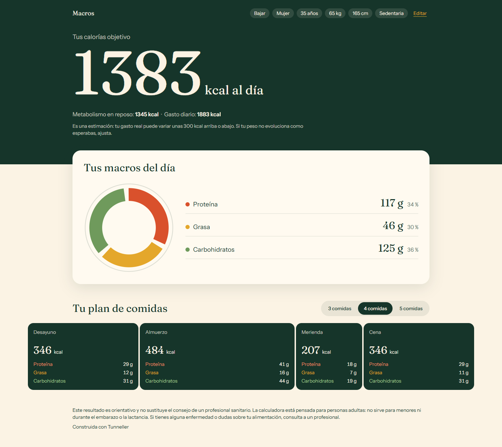

# Calculadora de macros

Responde seis preguntas y obtén en menos de un minuto tus calorías objetivo, tus macros del día y un plan de 3, 4 o 5 comidas. Es orientativa, funciona solo en el navegador y no guarda nada entre visitas.

**Pruébala:** https://tunneller-demo.github.io/macros/

Construida con Tunneller, como ejemplo público de lo que construye a partir de una idea poco definida.
